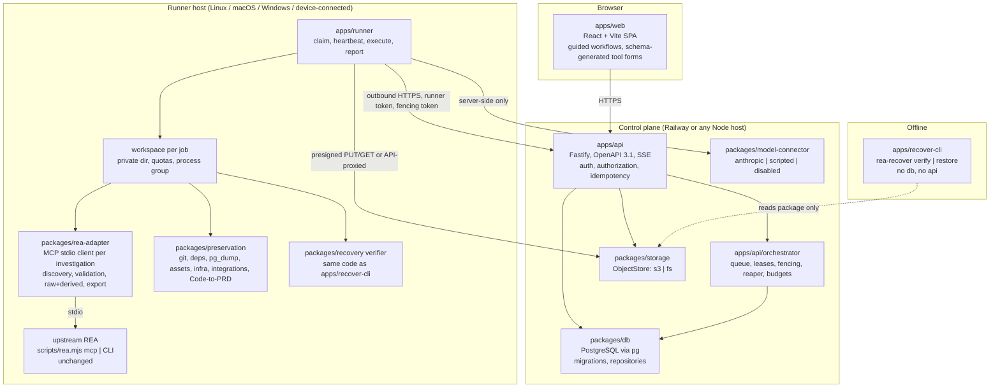

# Architecture

Companion to [SS00.md](SS00.md). This document describes the actual components,
their boundaries, data flows and the decisions behind them. Update it whenever
composition changes.

## 1. Component map



## 2. Boundaries and ownership

| Boundary                           | Owner                                    | Rule                                                                                                                                          |
| ---------------------------------- | ---------------------------------------- | --------------------------------------------------------------------------------------------------------------------------------------------- |
| Browser ↔ API                      | `apps/api`                               | Domain endpoints only. No shell, no arbitrary paths, no MCP passthrough. Every request authenticated and authorized against a project.        |
| API ↔ Runner                       | `packages/contracts` (`runner-protocol`) | Runner is outbound-only. Every mutating runner call carries `runner_id`, `job_id`, `fencing_token`. API validates lease ownership and expiry. |
| Runner ↔ upstream REA              | `packages/rea-adapter`                   | One process per investigation; stdio MCP; argument arrays; private workspace; allowlisted env; validated inputs; raw outputs retained.        |
| Runner ↔ target                    | `apps/runner`                            | Targets are files in the workspace or runner-local paths from the runner's own allowlist. Targets never execute in the API.                   |
| Runner ↔ model provider            | `packages/model-connector`               | Server-side credentials, redaction pass on inputs, usage accounting, abort on cancel.                                                         |
| Recovery package ↔ everything else | `packages/recovery`                      | Self-describing; verifier/restorer depend only on the package and declared prerequisites.                                                     |

## 3. Request lifecycle: investigation

1. `POST /projects/{p}/targets/uploads` → API streams the upload into object
   storage under `projects/{p}/targets/{id}/payload`, computing SHA-256 and
   sniffing the first bytes; the row records size, hash, detected kind.
2. `POST /projects/{p}/investigations` (idempotency key) → creates
   `investigation`, then a `job` of kind `investigation.run` with
   `requirements` derived from the routing table (first tool + providers) and
   `budget` from policy. Event `seq=1 job.created`.
3. Runner long-polls `POST /runners/{r}/claim` with its capability digest. The
   orchestrator selects the oldest `queued` job whose requirements the runner
   satisfies, inserts a `job_lease` with `fencing_token = previous + 1`,
   transitions to `preparing`, returns job + token.
4. Runner creates the workspace, downloads the target (API-proxied GET with the
   fencing token, or presigned URL when the store supports it), starts the REA
   MCP process, runs discovery, posts `job.running`.
5. Each tool call → `tool_call` row via `POST /jobs/{id}/tool-calls` (fenced)
   with raw result uploaded to `projects/{p}/investigations/{i}/raw/{seq}.json`.
6. Policy-gated tool (effects ∩ approval set ≠ ∅) → runner posts
   `awaiting_approval` with the proposed call; the UI shows it; approver calls
   `POST /jobs/{id}/approve` or `/reject`; runner resumes on its next heartbeat
   response.
7. End: `export_evidence_bundle` → upload → `evidence_artifact`; findings and
   obligations posted; `close_binary`; process-group kill; cleanup recorded;
   `POST /jobs/{id}/complete` (fenced) → `succeeded` or `failed`.
8. Browser follows `GET /jobs/{id}/events` (SSE). `Last-Event-ID` resumes from
   the persisted `seq`.

## 4. Durability design

- **Leases**: `job_lease(job_id PK, runner_id, fencing_token, expires_at)`.
  Claim: `UPDATE job SET state='preparing' WHERE id = (SELECT id FROM job WHERE
  state='queued' AND <requirements match> ORDER BY created_at FOR UPDATE SKIP
  LOCKED LIMIT 1)` in one transaction with lease upsert. Heartbeat extends
  `expires_at`. Reaper (API background loop, also safe to run multiple API
  instances): leases with `expires_at < now()` → job `interrupted` + event; the
  retry policy decides `queued` (attempt+1, new fencing token on next claim) or
  `failed`.
- **Fencing**: any `POST /jobs/{id}/*` from a runner carries the token; the API
  compares against the current lease in the same transaction that applies the
  change. Mismatch → `409 stale_lease`, logged as `job_event kind=stale_rejected`.
- **Idempotency**: `Idempotency-Key` header on mutation endpoints; the API
  stores `(project_id, key, request_hash, response)` for 24h; a repeat with the
  same hash returns the stored response, a repeat with a different hash returns
  `422 idempotency_conflict`.
- **Side-effect safety on retry**: runners record `effect_ledger` steps before
  non-repeatable actions (e.g. `install_adb_package`, writing a restore target).
  A retried attempt reads the ledger; a `started` step without `completed` makes
  the job `failed` with `non_repeatable_effect_ambiguous` rather than repeating.
- **Events**: `job_event(job_id, seq)` with `seq` assigned by
  `INSERT ... SELECT coalesce(max(seq),0)+1` under the job's row lock. SSE
  emits `id: <seq>`; resume replays `seq > Last-Event-ID` from the table, then
  tails via `LISTEN/NOTIFY` (`pg_notify('job_events', job_id)`).
- **Budgets**: runner samples rusage of the owned process group every second;
  enforces `wall_ms` by timer, `memory_bytes`/`cpu_ms` via `prlimit` when
  available and by observation otherwise, `disk_bytes` by workspace size
  checks, `tool_calls`/tokens by counters, `artifact_bytes` by upload
  accounting. The API also enforces `artifact_bytes` server-side.
- **Cancellation**: `POST /jobs/{id}/cancel` sets `cancel_requested_at`; the
  runner receives it in the heartbeat response, aborts the in-flight MCP call
  (request cancellation), calls `close_binary`, kills the process group, posts
  cleanup result, then `cancelled`.

## 5. Runner capability routing

Runner capability reports are stored verbatim (see SS00 §7) and summarised into
a `capability_digest` used for matching:

- `tools_available`: names whose group `available === true`.
- `tools_target_required`: names whose group `reason === "target_required"`.
- `providers_available`: candidates with `availability.status === "available"`.
- `host`: os/arch/gui/docker/adb facts.

A job's `requirements.tools` must be a subset of `tools_available ∪
tools_target_required` (target-required tools become available once
`open_binary` succeeds on a supported target; the runner records the actual
`analysis_provider_binding` after open). `requirements.providers` must be a
subset of `providers_available`. Unmet requirements are rendered in the UI from
the runner's own `reason` and `remediation` text. No runner → job stays
`queued` with `waiting_for_runner` detail listing the unmet requirements.

Railway Linux runner (when deployed): Node 22 + upstream REA only; it serves
the 63 target-free tools available on a bare Linux host at the pinned revision
plus `open_binary`-dependent tools only when a bring-your-own provider is
mounted. Nested Docker, GUI, devices and macOS/Windows tools are not claimed.

## 6. Storage layout (object store)

```
projects/{project_id}/targets/{target_id}/payload
projects/{project_id}/investigations/{inv_id}/raw/{seq}.json
projects/{project_id}/investigations/{inv_id}/evidence/{artifact_id}.json
projects/{project_id}/investigations/{inv_id}/export/{export_id}.zip
projects/{project_id}/builds/{build_id}/captures/{capture_id}/manifest.json
projects/{project_id}/builds/{build_id}/captures/{capture_id}/<component>/...
projects/{project_id}/builds/{build_id}/exports/{export_id}.tar
projects/{project_id}/builds/{build_id}/exports/{export_id}.tar.sig
```

Keys are derived server-side from validated IDs; clients never supply keys.
The `fs` backend is for local development and tests; `s3` is for Railway
buckets or any S3-compatible service. Both implement `put(stream)`, `get`,
`head`, `delete`, `list(prefix)` and optional `presign`.

## 7. Model connector

```
interface ModelProvider {
  id: "anthropic" | "scripted" | "disabled";
  complete(request: CompletionRequest, signal: AbortSignal): Promise<CompletionResult>;
}
```

`CompletionRequest` carries system text, messages, tool definitions (live MCP
`inputSchema`s), `max_tokens`. The follow-up loop in the runner:

1. Build context from derived summaries only (never raw secrets; redaction pass).
2. Ask for the next step; parse `tool_use` blocks.
3. Validate each call against the live schema (Ajv 2020 dialect) and the policy;
   reject invalid calls back to the model with the validation error (bounded
   retries).
4. Execute through the adapter; feed back `derived` summary plus a reference to
   the raw result; account usage; stop on budget, `end_turn`, or cancel.

The `scripted` provider replays a fixture transcript and is the only provider
used in tests; mocked provider tests are contract checks, not live-provider
support.

## 8. Preservation and recovery

Collectors implement:

```
interface Collector {
  id: ComponentKind;
  plan(input, ctx): Promise<ComponentPlan>;      // discovery, permissions, omissions
  capture(plan, ctx): Promise<ComponentCapture>; // writes files, returns entries + timestamps + status
}
```

The capture job runs collectors in a declared order (source, dependencies,
data, assets, infrastructure, integrations, product), records
`captured_at_start`/`captured_at_end` per component, and computes a
`consistency` block: `single_point` only when every stateful component was
captured inside the declared consistency window using a documented method;
otherwise `inconsistent` with the gaps listed.

The verifier (`packages/recovery/verifier`) reads only the package, checks
hashes, validates the manifest against the embedded JSON schema, and runs the
restore steps into a disposable directory and a disposable PostgreSQL database
with an environment that blocks production endpoints (`REA_RECOVERY_NETWORK=deny`
plus explicit blocklist of recorded production hostnames) and disables
schedules/webhooks (recorded in the manifest as `restore_guards`).

## 9. Deployment shape (Railway)

Services: `api` (Node), `web` (static, served by `api` or separate), `postgres`
(Railway plugin), `bucket` (Railway bucket or external S3), optional
`runner-linux`. Configuration via environment variable names listed in
[API.md](API.md#environment). Deployment configuration is prepared under
`deploy/` and validated locally; nothing is deployed from the development
session.

## 10. Decisions log

| ID    | Decision                                                                                             | Rationale                                                                                                  |
| ----- | ---------------------------------------------------------------------------------------------------- | ---------------------------------------------------------------------------------------------------------- |
| D-001 | Extension in `rea-web/` as its own npm workspace root                                                | Upstream root `package.json`, `turbo.json`, `knip.json` and CI stay byte-identical.                        |
| D-002 | Conform to upstream `oxfmt`/`oxlint` instead of adding ignore patterns                               | Root `format:check`/`lint` traverse the tree; keeping them green without config edits proves preservation. |
| D-003 | Primary integration via MCP stdio with the same SDK version as upstream                              | Documented, tested public boundary; schemas and effects come from the live server.                         |
| D-004 | PostgreSQL + S3-compatible storage with fs backend                                                   | Durability needs a transactional store; fs backend enables tests without Docker (unavailable here).        |
| D-005 | scrypt password hashing (Node built-in)                                                              | No native dependency; adequate for the control plane's own accounts.                                       |
| D-006 | Fastify + hand-written zod→OpenAPI projection                                                        | Single source of truth in `contracts`; served at `/openapi.json`.                                          |
| D-007 | Approval gate on `executesForeignCode`/`mutatesDevice`/`mayDiscardData`/`accessesNetwork` by default | Mirrors upstream effect vocabulary; keeps destructive effects explicit.                                    |
| D-008 | Verifier is the same code as the offline CLI                                                         | Eliminates divergence between in-platform and independent verification.                                    |
